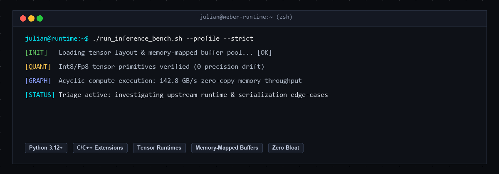

<div align="center">
  
</div>

<br/>

### Hi there, I'm Julian 👋

Systems and backend developer based in Munich, Germany. I focus on neural graph execution, tensor runtime optimizations, memory-mapped buffers, and low-latency inference pipelines.

```python
class FocusArea:
    languages = ["Python 3.12+", "C/C++", "Rust"]
    runtimes = ["PyTorch Primitives", "ONNX Runtime", "safetensors"]
    core_interests = [
        "Memory-mapped zero-copy IPC",
        "Deterministic graph execution",
        "Quantization kernels & SIMD",
        "Async event loops & socket buffers"
    ]
    doctrine = "Zero bloat. Deterministic execution. Comprehensive test coverage."
```

#### 🛠️ What I Work With
- **Languages:** Python, C++, C, SQL
- **Systems & Networking:** AsyncIO, memoryview, ctypes, sockets, zero-copy buffers
- **Tooling:** pytest, hypothesis, gdb, valgrind, clang-format, tox

---
*Clean diffs, isolated reproductions, and green CI.*
